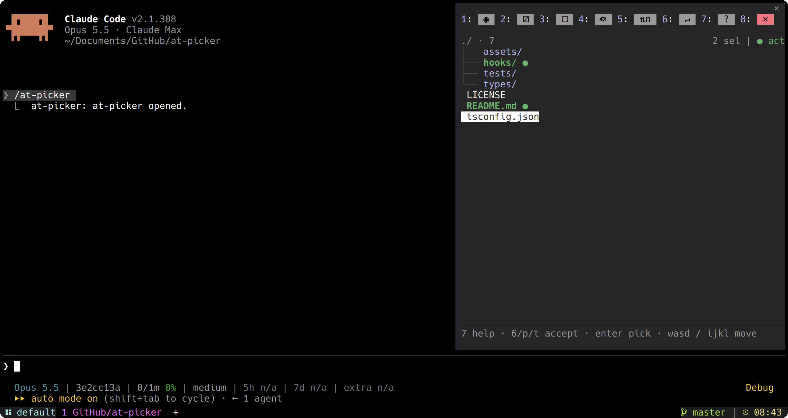
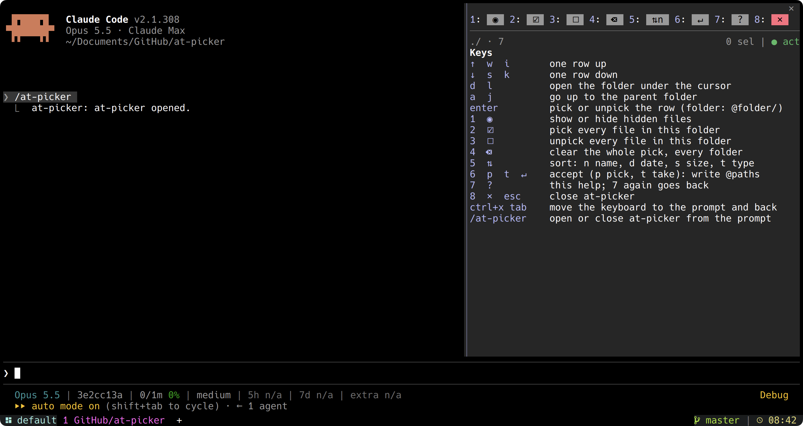

<p align="center">
  
</p>

<h1 align="center">at-picker</h1>

<p align="center">
  A keyboard-driven file picker pane for <a href="https://claude.com/claude-code">Claude Code</a> that writes
  <code>@path</code> mentions into your prompt.
</p>

<p align="center">
  
  
</p>

Typing `@` and guessing paths works when you know the file. When you don't, at-picker opens a pane beside the
conversation: browse the project as a tree, pick files and folders from several directories, then press one key to
insert them all as mentions. Claude Code attaches them when you send the prompt.

## Features

- **Tree view** of the working directory, folders first, with a clear marker for every pick.
- **Multi-select across folders.** Picks are kept while you move around, and accepted together.
- **Folders as mentions.** Picking a folder inserts `@folder/`, which Claude Code attaches as a directory listing.
- **Extra roots.** Directories added with `/add-dir` appear in their own section at the top level.
- **Keyboard first,** with WASD and IJKL on both hands, and a built-in key list (`7`).
- **Sort** by name, date, size or type. Show or hide dotfiles.
- **Adapts to the terminal.** Docked beside the transcript on wide screens, inline above the prompt on narrow ones,
  and drawn in your Claude Code theme colors, light or dark.
- **English and Spanish,** picked from your terminal locale.
- **Read-only and local.** No network, no files written, no dependencies.

## Requirements

Claude Code **2.1.308 or newer**. at-picker is a hooks-module plugin, and that plugin API is in early access: it was
built and tested on 2.1.308, and a later release may change it. Run `claude --version` to check yours.

## Install

At the prompt of a Claude Code session:

```
/plugin install at-picker --marketplace carlos-andres/at-picker
```

Answer `y` to add the marketplace, then choose a scope (user scope makes it available in every session).

From a shell:

```sh
claude plugin install at-picker --marketplace carlos-andres/at-picker
```

In the desktop app, where `/plugin` does not run: click **+** next to the prompt box, then **Plugins**,
**Add marketplace** with `carlos-andres/at-picker`, then **Add plugin**.

Update or remove it with `claude plugin update at-picker` and `claude plugin uninstall at-picker`.

## Usage

1. Type `/at-picker` to open the pane (the same command closes it).
2. Move with `w` / `s`, open a folder with `d`, go back up with `a`.
3. Press `Enter` on each file or folder you want. A picked row turns green with a `●`.
4. Press `6`, `p` or `t` to accept. The pane closes and the prompt receives the mentions, for example
   `@src/app.ts @tests/ `. Add your request and send.

Paths that contain spaces are quoted (`@"docs/user guide.md"`). A file deleted after you picked it is skipped.

## Keys

| Key | Action |
| --- | --- |
| `w` / `i` / `↑` | Move up one row |
| `s` / `k` / `↓` | Move down one row |
| `d` / `l` | Open the folder under the cursor |
| `a` / `j` | Go up to the parent folder |
| `Enter` | Pick or unpick the row (a folder inserts `@folder/`) |
| `1` | Show or hide hidden files |
| `2` | Pick every file in this folder |
| `3` | Unpick every file in this folder |
| `4` | Clear all picks, in every folder |
| `5` | Cycle the sort order: name, date, size, type |
| `6` / `p` / `t` | Accept: close the pane and insert the picks. `p` (pick) and `t` (take) let you accept without moving your hand from the letter keys |
| `7` | Show or hide the key list |
| `8` / `Esc` | Close the pane |
| `Ctrl+X` `Tab` | Move the keyboard between the pane and the prompt |

The toolbar shows keys `1` to `8` as icons. The status row shows how many items are picked and whether the pane has
the keyboard (`● act`) or the prompt does (`○ deact`).

## Optional shortcut

Claude Code binds no key to `/at-picker`. To open and close it with `Ctrl+X` `A`, add this to
`~/.claude/keybindings.json` (merge it if the file already has a `Chat` context):

```json
{
  "bindings": [
    { "context": "Chat", "bindings": { "ctrl+x a": "command:at-picker" } }
  ]
}
```

## Settings

Claude Code asks for them when you install the plugin. To see them or change them later:

```sh
claude plugin configure at-picker
```

| Setting | Default | Description |
| --- | --- | --- |
| `icons` | `unicode` | `unicode` uses glyphs any monospace font draws. `nerd` uses Nerd Font icons. |
| `uiLanguage` | `auto` | `auto` follows the terminal locale (`LC_ALL`, `LC_MESSAGES`, `LANG`). Or `en`, `es`. |
| `dockWidthPercent` | `30` | Dock width as a share of the terminal. Claude Code keeps it between 24 columns and 45%. |
| `inlineMode` | `panel` | Below 110 columns: `panel` shows the picker inline above the prompt, `message` shows a notice instead. |
| `inlineRows` | `20` | Rows requested for the inline picker. Claude Code trims it to the space available. |
| `showHidden` | `false` | List dotfiles and dot-folders by default. Key `1` toggles them for the session. |
| `sortDirs` | `false` | Apply the sort order to folders too. Folders are always listed first. |
| `debug` | `false` | Log pane sizes and actions to Claude Code's debug log (`claude --debug`). For development. |

## Layout

The pane docks beside the transcript when the terminal is at least 110 columns wide and Claude Code runs in
fullscreen. Otherwise it opens inline above the prompt. You can drag the dock's edge to resize it, and the width you
set takes priority over `dockWidthPercent`.

The dock width is calculated when the pane opens. After you resize the terminal, run `/at-picker` twice to reopen
it at the new size. In a narrow dock the toolbar wraps into rows of four (or three) icons.

## Privacy

at-picker only reads. It lists directories under your working directory and the roots you added with `/add-dir`,
reads the `HOME` and locale environment variables, and reads `permissions.additionalDirectories` from your Claude
Code settings. It sends nothing over the network and writes no files. The paths you accept go into the prompt, which
you review before sending.

## Known limitations

- **A name with both a space and a double quote** (`my "draft".md`) cannot be mentioned: Claude Code reads a quote
  in an unquoted mention and a space inside `@"..."`, but has no escape for both together. at-picker leaves such a
  pick out when you accept and tells you how many it skipped.
- **Wide characters** (CJK, emoji) are counted as one cell, so a long name that holds them may be cut later than
  it should. Accented letters such as `á` or `ñ` are not affected.
- **Folders passed with `--add-dir` at startup** are not listed in the extra-roots section: Claude Code does not
  report them to plugins. Folders added with `/add-dir` during the session are listed, and so are the ones saved in
  your settings (`permissions.additionalDirectories`, the "remember" choice of `/add-dir`). To see a folder there
  in every session, save it in your settings instead of passing the flag.

## Development

Run the plugin from a clone without installing it:

```sh
claude --plugin-dir /path/to/at-picker
```

Check and test it:

```sh
claude plugin validate .
claude plugin test .
tsc -p .
```

Type-checking needs TypeScript 5.4 or newer; it was last checked with TypeScript 7.0.2. The API types are not in the
repository: Claude Code writes them to `.claude-plugin/types/` the first time it loads the plugin with `--plugin-dir`,
for the version you run, so start one session before running `tsc`.

The pane is a Claude Code hooks module: [`hooks/register.tsx`](hooks/register.tsx) draws it,
[`hooks/list.ts`](hooks/list.ts) holds the pure list helpers, and [`hooks/i18n.ts`](hooks/i18n.ts) holds the English and
Spanish strings. Tests live in [`tests/`](tests).

## License

[MIT](LICENSE) © 2026 Carlos A Loaiza O
